<div align="center">



</div>

<p align="center">
  <strong>The Universal Graph-Native Kernel & Declarative AST for Autonomous AI Systems, Massive Codebases, High-Concurrency Engines & Distributed SRE</strong>
</p>

<p align="center">
  <a href="https://jackstar6677-1.github.io/omniast/"></a>
</p>

<p align="center">
  <a href="#key-innovations"></a>
  <a href="#token-efficiency"></a>
  <a href="#mega-ui-design-system--pluggable-visual-themes"></a>
  <a href="#supported-targets"></a>
  <a href="#tree-sitter-grammar"></a>
  <a href="#hermes--openclaw-skills-ecosystem"></a>
  <a href="#license"></a>
</p>

---

## 🌌 What is OmniAST (GraphLang)?

**OmniAST** (also known as **GraphLang**) is an intermediate, declarative programming language, compiler infrastructure, and kernel runtime engineered for the modern software paradigm: **collaboration between autonomous AI models (Google DeepMind Antigravity, OpenAI Codex, Anthropic Claude, DeepSeek, Grok) and massive, high-throughput software architectures.**

Traditional programming languages (Java, C++, Rust, Python, Go) were engineered decades ago for humans typing characters into flat ASCII text files. They are filled with ceremonial syntactic overhead: thousands of redundant import statements, repetitive type declarations, package definitions, access modifiers, and file-system hierarchies. When modern AI models read and reason through these codebases, **millions of tokens are wasted on boilerplate syntax rather than core business logic and system architecture**.

**OmniAST changes this equation fundamentally:**
1. **Direct AST & Graph Representation:** Code is authored, navigated, and represented directly as an **Executable Abstract Syntax Tree & Dependency Graph**.
2. **Universal AI Interoperability:** Any AI agent or human can read, mutate, query, and verify complete architectures with minimal token cost.
3. **Massive Codebase Scalability:** Operates natively across enterprise repositories with 100k+ files by loading localized topological subgraphs instead of bloating context windows with linear text.
4. **Universal Multi-Target Compilation:** Write once in OmniAST; compile deterministically to **Java 21/25 (Paper/JVM)**, **Native Rust/Tokio (Panama FFI & Axum Web)**, **Asynchronous Python**, **Standalone WebAssembly (WASM/WAT)**, or **OmniWeb Reactive SPAs ready for GitHub Pages**.

> [!WARNING]
> **Experimental State & Community/AI Pull Request Mandate:**  
> OmniAST is in active, rapid evolution (v0.1.0-draft). Edge-case AST bugs and transpiler gaps may be encountered.  
> **Both human developers and autonomous AI models** using OmniAST are requested to submit Pull Requests or issues for any bug or grammar gap discovered. All submissions must be **globally applicable** (no niche/single-server hacks) and strictly adhere to our **Zero-Leak Privacy Policy**. See [`CONTRIBUTING.md`](CONTRIBUTING.md).

---

## ⚡ Key Innovations

```
                       ┌─────────────────────────────────────────┐
                       │          OmniAST Declarative Node       │
                       │           (85% Fewer Tokens)            │
                       └────────────────────┬────────────────────┘
                                            │
                                 ┌──────────┴──────────┐
                                 ▼                     ▼
                       ┌──────────────────┐   ┌──────────────────┐
                       │  Agent Reasoning │   │  Graphify Memory │
                       │ (Claude · Codex  │   │ (AST & Community │
                       │  Antigravity)    │   │    Knowledge)    │
                       └─────────┬────────┘   └────────┬─────────┘
                                 │                     │
                       ┌─────────▼─────────────────────▼─────────┐
                       │             OmniAST Kernel              │
                       │     Typecheck · Validate · Transpile    │
                       └────────────────────┬────────────────────┘
                                            │
           ┌─────────────────┬──────────────┴───────┬─────────────────┐
           ▼                 ▼                      ▼                 ▼
  ┌──────────────────┐ ┌───────────────┐  ┌──────────────────┐ ┌───────────────┐
  │  JVM (Java 21+)  │ │ Native (Rust) │  │ Asynchronous Py  │ │ WebAssembly   │
  │  Paper / Purpur  │ │ Tokio / LLVM  │  │ SRE Sentinels    │ │ Edge / WASI   │
  │  Enterprise Apps │ │ Panama FFI    │  │ Fleet Monitoring │ │ Browser Engine│
  └──────────────────┘ └───────────────┘  └──────────────────┘ └───────────────┘
```

* **Token-Efficient by Design:** Cuts down model context consumption by 70% to 85% compared to raw Java, Rust, or C++.
* **Scale Without Context Exhaustion:** Models can modify complex logic across thousands of classes without hitting context limits by querying only connected AST subgraphs.
* **Domain-Agnostic:** Built for distributed cloud services, high-concurrency microservices, industrial automation, and game server engines alike.
* **AST First, Text Second:** Fully backed by a Tree-sitter formal grammar and AST graph databases for instant topological querying and zero-cost structural diffs.

---

## 🏢 Enterprise & Massive Codebase Architecture (Beyond Game Engines)

While OmniAST was demonstrated in high-concurrency event-driven platforms (such as Minecraft Paper/Purpur game servers), its design is **strictly domain-agnostic and built for hyperscale systems**:

- **Enterprise Microservices:** Define distributed state machines, gRPC interfaces, and idempotent transactional gates across hundreds of microservices.
- **Event-Driven Cloud Backends:** Express Kafka/RabbitMQ consumer logic, circuit breakers, and rate limiters declaratively in under 15 lines of IR.
- **Autonomous SRE & Self-Healing Swarms:** Sentinel nodes continuously observe distributed infrastructure, quarantine regression candidates, and throttle alerts to eliminate on-call alert fatigue.
- **Cross-Language Code Migration:** Ingest legacy Java or Python codebases into OmniAST's unified graph representation and re-emit them into high-performance Rust or WebAssembly.

---

## 🛠️ Code Examples

### 1. In-Engine Safety & Event Routing (JVM / Rust target)

```omniast
module OdysseiaSafety {
    version: "2.1.0"
    target: [jvm, rust]

    listener ChatFilter on player.chat priority(lowest) {
        guard event.message.contains_hate_speech()

        cancel
        actor.ban(reason="Zero tolerance policy", ip=true)
        world.strike_lightning(actor.location)
        notify discord.mod_channel, "Blocked & banned attacker: " + actor.name
    }
}
```

### 2. Autonomous SRE Sentinel & Daemon (Python / Rust target)

```omniast
module StagingSentinel {
    version: "1.0.0"
    target: [py, rust]

    sentinel StagingFleetSupervisor {
        interval: 30m
        target: systemd("production-fleet-service")

        on failure {
            quarantine_faulty_jars()
            alert(operator="admin", channel="discord", throttle=12h)
        }

        on progress(port_ok) {
            log "Fleet progress: " + port_ok.addon_name
            # Anti-spam: Suppresses notifications when no human intervention is needed
        }
    }
}
```

### 3. Industrial Mechanics & High-Throughput Energy Buffers (WASM / Rust target)

```omniast
module QuantumPowerGrid {
    version: "1.0.0"
    target: [rust, wasm]

    machine QuantumCapacitor : EnergyStorage {
        capacity: 250000 J
        rate: 2000 J/s

        on tick(delta) {
            if network.has_deficit {
                route self.stored -> network.bus, max=rate
            }
        }
    }
### 4. OmniWeb: Declarative Full-Stack Web & GitHub Pages Reactive SPA

```omniast
module OmniStudio {
    version: "1.0.0"
    target: [web, rust]

    page PortalIndex path="/" {
        title: "OmniStudio · Reactive Portal"
        layout: "SovereignShell"
        signal counter = 42
        signal activeMode = "high-performance"
    }

    model AgentTask {
        id: uuid primary_key
        title: string
        status: string
        priority: int
    }

    endpoint GET "/api/v1/tasks" {
        guard actor.is_authenticated()
        cache ttl=15s
    }
}
```

```bash
# 1. Compile directly into a self-contained, reactive SPA for GitHub Pages (<2KB Micro-Signals store)
omniast web build -i examples/fullstack_cluster.omni -o docs/index.html --theme sovereign

# 2. Preview the reactive application locally with live theme switcher
omniast web serve -i examples/fullstack_cluster.omni --port 8080

# 3. Export Standalone Sovereign CSS Design System
omniast web css -o dist/omni-ui.css

# 4. Generate a complete Full-Stack Project (Axum Rust Backend + GitHub Pages Frontend)
omniast fullstack generate -i examples/fullstack_cluster.omni -o out_cluster --theme cyberpunk
# Result:
# out_cluster/
# ├── backend/
# │   ├── Cargo.toml          (Tokio, Axum, Serde)
# │   └── src/main.rs         (Axum router & handlers)
# ├── frontend/
# │   └── index.html          (Reactive SPA for GitHub Pages)
# └── README.md
```

### 🎨 Mega-UI Design System & Pluggable Visual Themes

OmniAST features an ultra-modern, zero-dependency design system (`omni-ui.css`) with 4 built-in themes:
- **`sovereign`:** Glassmorphism, Bento Grid layout, deep dark background, amethyst purple and cyan accents.
- **`cyberpunk`:** High-contrast tactical dark slate, neon cyan and electric magenta glows, angular borders.
- **`terminal`:** Classic retro CRT monitor, phosphor green monochrome palette, monospace typography.
- **`minimal`:** Stripe and VitePress inspired clean documentation theme with high-contrast neutral slate.

#### 🌈 1. GPU-Accelerated Animated RGB Borders
Bypasses JavaScript overhead by driving color rotations entirely on the compositor thread using modern CSS Houdini properties:
```css
@property --rgb-angle {
  syntax: '<angle>';
  initial-value: 0deg;
  inherits: false;
}
@keyframes rgb-spin-border {
  0% { --rgb-angle: 0deg; }
  100% { --rgb-angle: 360deg; }
}
```
Available via the `.rgb-card` and `.rgb-glow` utility classes.

#### 📜 2. Scroll-Driven Progress Bar & Viewport Reveals
- Top scroll progress bar (`#scroll-progress`) automatically tracks root document progress via `animation-timeline: scroll(root block)` with fallback for legacy browsers.
- Viewport content cards reveal progressively as the user scrolls down with `.reveal-on-scroll`.

#### ⏳ 3. Loaders, Quantum Pulses & Shimmer Skeletons
- **Shimmer Skeletons:** Animated placeholder states (`.skeleton`, `.skeleton-text`, `.skeleton-title`, `.skeleton-card`) for asynchronous data fetching.
- **Quantum Core Loader:** Triple counter-rotating rings with glowing radial gradients (`.loader-quantum`).
- **SRE Sonar Radar:** Continuous 360° radar sweep with glowing sweep beam and target pulse blips (`.loader-radar`).

#### 🎨 4. In-Browser Texture Studio
Built directly into the web runtime with zero external dependencies:
- **Interactive Pixel Painter:** 16x16 / 32x32 HTML5 Canvas editor with a 7-color sovereign palette, pencil, eraser, clear canvas, and one-click PNG download.
- **Procedural Generators:** Instant generation of *Carbon Fiber*, *Cyber Grid*, *Hexagonal Honeycomb*, *CRT Scanlines*, and *Netherite Tile* patterns.
- **Texture Uploader:** Drag-and-drop or select any image (PNG, JPG, WebP, SVG).
- **Live 3D Card Preview:** Maps the generated or uploaded texture with seamless tiling across Glassmorphic UI surfaces.

#### ⚡ 5. Animated & Static SVG Engine
Native support for vector graphics with keyframe-driven path manipulation:
- **Quantum Reactor Core:** Concentric spinning rings with gradient fills and ambient drop-shadow pulse.
- **Sonar Radar Grid:** Vector circular axes with animated sweep beam and target indicators.
- **Circuit Stream:** Neon circuit traces with infinite `stroke-dashoffset` flow animations.
- **Live SVG Playground:** Paste raw `<svg>...</svg>` markup into the web UI for instant interactive rendering.

---

## 💻 Complete CLI Command Reference

OmniAST provides a unified, ergonomic command-line interface for the entire development lifecycle:

| Command | Arguments | Description |
|---|---|---|
| `omniast parse` | `-i <file.omni> [-o <out.json>] [-c]` | Parse `.omni` source into normalized AST JSON. Optional `-c` enables token compression. |
| `omniast transpile` | `-i <file.omni> -t <target> [-o <out>]` | Transpile to JVM (`jvm`), Rust (`rust`), Python (`py`), TypeScript (`ts`), WASM (`wasm`/`wat`), or Web (`web`). |
| `omniast web build` | `-i <file.omni> [-o docs/index.html] [--theme sovereign]` | Compile self-contained reactive SPA ready for GitHub Pages (<40KB runtime). |
| `omniast web serve` | `-i <file.omni> [-p 8080] [--theme sovereign]` | Launch local HTTP preview server with live theme switcher and Texture Studio. |
| `omniast web css` | `[-o dist/omni-ui.css]` | Export standalone Sovereign CSS design system (`omni-ui.css`). |
| `omniast fullstack generate` | `-i <file.omni> [-o out_dir] [--theme sovereign]` | Generate complete Axum Rust backend (`Cargo.toml` + `main.rs`) and Reactive Web frontend. |
| `omniast compress` | `-f <file> [--type ast\|logs]` | Compress AST or logs by 60-90% using Headroom context-saver engine. |
| `omniast memory` | `[-d] [-r "decision"] [-c category]` | Inspect or record cross-session architectural decisions (claude-mem compatible). |
| `omniast skills` | `[-f hermes\|openclaw]` | Export native tool schemas for NousResearch/hermes-agent and OpenClaw. |
| `omniast accounts` | `[-p provider] [--json]` | Inspect and manage multi-account AI broker failover pools. |
| `omniast export-agent` | `-f hermes\|openclaw\|saori\|mcp` | Export drop-in integration configurations for autonomous agent runtimes. |

---

## 🌳 Phase 5: Tree-Sitter Grammar & Editor Tooling

OmniAST features a complete formal **Tree-sitter grammar (`tree-sitter-omniast`)** supporting instant syntax highlighting, code folding, and semantic scope resolution:

- **Formal Grammar:** [`tree-sitter-omniast/grammar.js`](tree-sitter-omniast/grammar.js)
- **Queries:**
  - Highlighting: [`tree-sitter-omniast/queries/highlights.scm`](tree-sitter-omniast/queries/highlights.scm)
  - Scopes & Locals: [`tree-sitter-omniast/queries/locals.scm`](tree-sitter-omniast/queries/locals.scm)
  - Code Folding: [`tree-sitter-omniast/queries/folds.scm`](tree-sitter-omniast/queries/folds.scm)
  - Auto-Indents: [`tree-sitter-omniast/queries/indents.scm`](tree-sitter-omniast/queries/indents.scm)

### VS Code Extension
Installable from [`editors/vscode`](editors/vscode):
- Provides native `.omni` and `.omniast` language detection.
- Full TextMate & Tree-sitter grammar support with dark/light theme integration.

### Neovim Integration
Add to your Neovim configuration via `nvim-treesitter`. See [`editors/neovim/README.md`](editors/neovim/README.md) for step-by-step instructions.

---

## ⚡ Phase 6: Self-Hosting Runtime & WebAssembly (WASM)

OmniAST provides a dual self-hosting execution runtime:
1. **Native Standalone Engine (`runtime/`):** Written in Rust with zero-allocation AST structures, cycle detection, and Panama FFI bindings.
2. **WebAssembly Compiler:** Compiles `.omni` modules into validated WebAssembly binary (`.wasm`) or WebAssembly Text (`.wat`) for browser-based sandboxes, Node.js edge workers, and Cloudflare Workers.

```bash
# Compile directly to WebAssembly Binary (.wasm)
omniast transpile --input examples/industrial_machine.omni --target wasm --output dist/machine.wasm

# Transpile to WebAssembly Text representation (.wat)
omniast transpile --input examples/industrial_machine.omni --target wat --output dist/machine.wat
```

---

## 🚀 Getting Started

### Installation

```bash
git clone https://github.com/JackStar6677-1/omniast.git
cd omniast
pip install -e .
```

### CLI Quickstart

```bash
# 1. Parse an OmniAST module into an AST dependency graph
omniast parse --input examples/industrial_machine.omni

# 2. Transpile to Native Rust / Tokio with Panama FFI bindings
omniast transpile --input examples/industrial_machine.omni --target rust --output ./dist/machine.rs

# 3. Transpile to Java 21+ Paper / Spigot Plugin code
omniast transpile --input examples/odysseia_safety.omni --target jvm --output ./dist/SafetyPlugin.java

# 4. Transpile to Asynchronous Python SRE Daemon
omniast transpile --input examples/sre_sentinel.omni --target py --output ./dist/sentinel.py

# 5. Transpile to TypeScript / Node.js (OpenClaw & Hermes Compatible)
omniast transpile --input examples/odysseia_safety.omni --target ts --output ./dist/safety.ts

# 6. Compile to Standalone WebAssembly Binary
omniast transpile --input examples/industrial_machine.omni --target wasm --output ./dist/machine.wasm

# 7. Export Hermes Function Calling Schemas or OpenClaw Skills
omniast skills --format hermes
omniast skills --format openclaw

# 8. Run the Kernel Test Suite
python -m unittest discover -s tests
```

---

## 🤖 AI Agent & MCP Integration (Zero Context Exhaustion)

OmniAST ships with a native **Model Context Protocol (MCP)** server and universal agent prompt. Any AI assistant (Antigravity, Codex, Claude, DeepSeek, Grok) can connect to the OmniAST Kernel:

### MCP Server Configuration (`mcp.json`)

```json
{
  "mcpServers": {
    "omniast": {
      "command": "python",
      "args": ["/path/to/omniast/mcp_server/server.py"]
    }
  }
}
```

### Universal Agent Prompt
Equip your AI agent with [`prompts/universal_agent_prompt.md`](prompts/universal_agent_prompt.md). The agent will automatically adopt graph-first navigation, bypass linear file scans, formulate code in `.omni` declarative blocks, and enforce **Zero-Noise Alert Throttling** for automated daemons.

---

## 🌐 SRE Multi-Agent Swarm & Live Web Console

OmniAST features an autonomous **Site Reliability Engineering (SRE) Swarm** designed for multi-tenant, multi-repository continuous repair:

* **Autonomous Code Repair:** Detects syntax failures, concurrency leaks, and null pointers; formulates minimal patch deltas.
* **Proactive Code Suggestions:** Suggests architectural and performance improvements based on AST node dependencies.
* **Multi-Account Model Pools (SAORI Pattern):** Transparently pools multiple accounts per provider (e.g. `codex-1` Terra primary with failover to `codex-2` Luna backup; `antigravity-1` prime with failover to `antigravity-2`; `claude-1` Opus with `claude-2` Haiku).
* **Automated Circuit Breaker:** Detects rate limits (429), quota exhaustion, or timeouts. After 3 consecutive failures, automatically trips the circuit to `SLEEPING` and fails over to secondary backup without aborting the task.
* **Terminal CLI & Web Dashboard:** Inspect live pool health via `omniast accounts` or via the interactive web console:

```bash
# Inspect all configured model pools and failover status
omniast accounts

# Launch the SRE Live Web Console (default port 8089)
python -m sre.web.server 8089
```

Open your browser at `http://localhost:8089/dashboard` to inspect real-time agent allocations, active model failover pools, and WebSocket telemetry.

---

## 🦅 Agentic Framework Ecosystem (Hermes Agent · OpenClaw · SAORI)

OmniAST bridges the graph kernel directly into leading autonomous AI architectures, enabling any agent to manipulate code with **85% fewer tokens**:

### 1. [NousResearch/hermes-agent](https://github.com/NousResearch/hermes-agent) Native Skill
* **Drop-in Skill:** Located in [`integrations/hermes_agent/omniast_hermes_skill.py`](integrations/hermes_agent/omniast_hermes_skill.py). Drop into `~/.hermes/skills/omniast/` to give Hermes Agent native graph AST parsing and cross-compilation tools.
* **RL & Fine-Tuning Trajectories:** Natively records interactions in ShareGPT / Hermes format via `omniast_record_trajectory`, allowing teams to fine-tune future Hermes checkpoints on OmniAST reasoning paths.

### 2. [OpenClaw](https://github.com/openclaw/openclaw) Plugin
* **TypeScript Omnichannel Plugin:** Located in [`integrations/openclaw/`](integrations/openclaw/). Enables OpenClaw daemons (90% TS) to route code generation and SRE triage across Discord, WhatsApp, In-Game RCON, and Webhooks.

### 3. [SAORI](https://github.com/JackStar6677-1/saori) Core & SRE Swarm
* **Bridge & Shared Memory:** Located in [`integrations/saori/saori_omniast_bridge.py`](integrations/saori/saori_omniast_bridge.py). Bridges the Multi-Account Model Broker (Antigravity Prime/Backup, Codex Terra/Luna, Claude Opus/Haiku) with SQLite WAL shared memory.

### 4. Universal Agent Adapter (Any Framework)
Export native configuration files for any agent framework in a single terminal command:
```bash
# Export Hermes Agent Function Calling Schemas
omniast export-agent --framework hermes

# Export OpenClaw Plugin Manifest
omniast export-agent --framework openclaw

# Export Standard MCP Tool Manifest
omniast export-agent --framework mcp
```

* **Architectural Blueprint:** Read the complete master study on unifying SAORI, OpenClaw, Hermes, and OmniAST in [`docs/architecture/SAORI_OPENCLAW_HERMES_UNIFICATION.md`](docs/architecture/SAORI_OPENCLAW_HERMES_UNIFICATION.md).

---

## 🧭 Project Roadmap

- [x] **Phase 1: Concept & Initial Architecture** (Kernel data structures, AST definitions, animated banner).
- [x] **Phase 2: Core Transpiler Suite** (Java 21+ Paper/Spigot, Asynchronous Python SRE, Native Rust/Tokio FFI).
- [x] **Phase 3: Agent Driver & MCP Server** (Native JSON-RPC 2.0 MCP server for Claude, Codex, Antigravity, DeepSeek, Grok).
- [x] **Phase 4: Unified CLI & Test Suite** (`omniast` command-line interface, automated unit tests, GitHub Actions CI).
- [x] **Phase 5: Tree-Sitter Grammar (`tree-sitter-omniast`)** (Formal grammar definition, syntax highlighting for VS Code & Neovim).
- [x] **Phase 6: Self-Hosting Runtime** (Compiling OmniAST to native WebAssembly & standalone binaries).
- [x] **Phase 7: Full-Stack Axum Engine (v0.2.0)** (Unified declarative `.omni` spec emitting Axum Rust backends, Serde data models, and reactive SPAs).
- [x] **Phase 8: Mega-UI Engine & Sovereign Portal (v0.3.0)** (Animated RGB borders via CSS Houdini, Scroll-driven progress bar, In-Browser Texture Studio with canvas pixel editor, SVG animation engine, and GitHub Pages master deployment).

---

## 🤝 Contributing
 
Contributions are welcome from human developers and autonomous AI agents!
- Please read [`CONTRIBUTING.md`](CONTRIBUTING.md) for contribution rules, the Pull Request protocol, and privacy firewall requirements.
- Review [`spec/LANGUAGE_SPEC.md`](spec/LANGUAGE_SPEC.md) for AST specifications and grammar details.

## 📄 License

OmniAST is open-source software released under the [MIT License](LICENSE).
